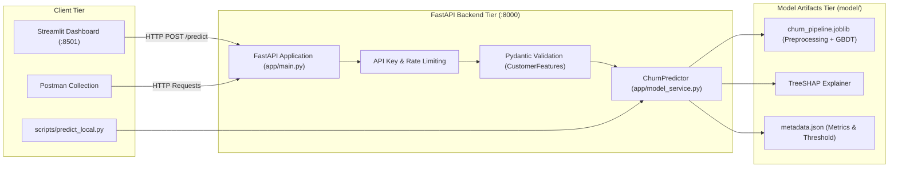

# ConnectTel Churn Predictor: End-to-End Deployment

A production-style machine learning service that predicts telecommunication customer churn and provides individual feature attributions using TreeSHAP.
Scikit-learn pipeline → FastAPI backend → Streamlit dashboard → Docker → Google Cloud Run.

**Live app:** https://YOUR-FRONTEND-URL  
**API docs:** https://YOUR-API-URL/docs

---

## Architecture




<!-- TODO: add docs/dashboard.png screenshot here -->

---

## Project Structure

```text
churn-capstone/
├── .github/
│   └── workflows/
│       └── ci.yml               # Automated CI (lint, format, tests, docker)
├── app/
│   ├── config.py                # Environment configuration (Pydantic Settings)
│   ├── features.py              # Feature groupings and human-readable formatting
│   ├── main.py                  # FastAPI application with lifespan management
│   ├── model_service.py         # ChurnPredictor, risk levels, and SHAP attribution
│   ├── schemas.py               # Pydantic request/response validation schemas
│   └── security.py              # Constant-time API key verification
├── data/
│   └── WA_Fn-UseC_-Telco-Customer-Churn.csv  # IBM Telco customer dataset
├── docs/                        # Project documentation and screenshots
├── frontend/
│   ├── .streamlit/
│   │   └── config.toml          # Dark theme configuration
│   ├── api_client.py            # HTTP client with timeouts and friendly errors
│   ├── Dockerfile               # Streamlit container definition
│   ├── requirements.txt         # Pinned frontend dependencies
│   └── streamlit_app.py         # Terminal-styled Streamlit dashboard
├── model/
│   ├── churn_pipeline.joblib    # Serialized scikit-learn pipeline (preprocessor + GBDT)
│   └── metadata.json            # Model parameters, evaluation metrics, and threshold
├── notebooks/
│   └── 01_eda.ipynb             # Exploratory Data Analysis with executed outputs
├── postman/
│   └── churn_api.postman_collection.json  # Postman v2.1 automated test suite
├── scripts/
│   ├── __init__.py
│   └── predict_local.py         # Standalone offline CLI prediction script
├── tests/
│   ├── conftest.py              # Pytest fixtures and mock client
│   ├── test_api.py              # FastAPI endpoint tests
│   ├── test_api_client.py       # Streamlit API client tests
│   ├── test_features.py         # Feature label transformation tests
│   ├── test_model_service.py    # Predictor and risk band unit tests
│   └── test_predict_local.py    # Local inference CLI smoke tests
├── Dockerfile                   # FastAPI backend container definition
├── docker-compose.yml           # Multi-container local orchestration
├── pyproject.toml               # Ruff and Pytest project configurations
├── requirements.txt             # Pinned production backend dependencies
├── requirements-dev.txt         # Development, testing, and EDA dependencies
└── README.md                    # Project documentation
```

---

## Model & Evaluation

- **Dataset:** IBM Telco Customer Churn (7,043 customers, ~26.5% historical churn).
- **Ethics:** `gender` is excluded to avoid using a protected attribute directly. Customer identifiers (`customerID`) are dropped.
- **Pipeline:** Continuous variables (`StandardScaler`) and categorical features (`OneHotEncoder(handle_unknown="ignore")`) combined via `ColumnTransformer` with `GradientBoostingClassifier`.
- **Threshold Optimization:** Due to the ~26.5% class imbalance, the decision boundary is tuned on out-of-fold cross-validation predictions to maximize the F1 score. The selected decision threshold is **0.348** (compared to a default 0.5 cutoff).

### Test Set Performance (Held-Out Evaluation)

| Metric | Final Model (Gradient Boosting) | Baseline (Logistic Regression) |
|:---|:---:|:---:|
| **ROC AUC** | **0.8471** | 0.8423 |
| **Recall** | **0.7219** | 0.5588 |
| **Precision** | **0.5672** | 0.6572 |
| **F1 Score** | **0.6353** | 0.6040 |
| **Accuracy** | **0.7800** | 0.8055 |
| **Decision Threshold** | **0.3480** | 0.5000 |

*Evaluation metrics recorded in `model/metadata.json` across 1,409 held-out test rows.*

---

## Local Setup

### 1. Environment Configuration

```bash
# Clone the repository and navigate into the root directory
cd churn-capstone

# Create and activate Python 3.11 virtual environment
python -m venv .venv
# Windows PowerShell:
.venv\Scripts\Activate.ps1
# Linux / macOS:
source .venv/bin/activate

# Install all development and runtime dependencies
pip install -r requirements-dev.txt

# Configure environment variables
cp .env.example .env
# Edit .env to set your API_KEY (optional for local unauthenticated development)
```

### 2. Standalone Local Inference Script

You can run local predictions directly from model artifacts without starting the FastAPI server:

```powershell
# Run with built-in default customer profile
python -m scripts.predict_local

# Run with a custom JSON customer profile
python -m scripts.predict_local --file path/to/customer.json
```

### 3. Launch Backend and Frontend

```powershell
# Retrain model (optional; model artifacts are already included)
python -m training.train

# Start FastAPI server on port 8000
uvicorn app.main:app --reload --port 8000

# In a separate terminal, launch Streamlit dashboard on port 8501
streamlit run frontend/streamlit_app.py
```

---

## Postman Collection

An automated Postman test collection is provided in `postman/churn_api.postman_collection.json` (Postman v2.1 format).

### Configured Collection Variables
- `baseUrl`: Base API URL (default: `http://localhost:8000`).
- `apiKey`: Authentication key (default placeholder: `PASTE_YOUR_KEY_HERE`).

### Test Requests Included
1. `GET /health`: Asserts status `200`, `status == "ok"`, and `model_loaded == true`.
2. `POST /predict (Valid)`: Asserts status `200` and validates all response fields.
3. `POST /predict (Invalid Tenure)`: Passes string `"twelve"` and asserts status `422 Unprocessable Entity`.
4. `POST /predict (Missing API Key)`: Omits `X-API-Key` and asserts status `401 Unauthorized` (when `API_KEY` is configured).
5. `GET /model/info`: Asserts status `200` and verifies exposed metrics and threshold.

---

## API Documentation & Examples

### Endpoints Overview

| Method | Path | Description | Authentication |
|:---|:---|:---|:---|
| `GET` | `/health` | Service liveness and model readiness probe | None |
| `POST` | `/predict` | Predict churn probability, risk tier, action, and SHAP reasons | `X-API-Key` |
| `GET` | `/model/info` | Inspect model training parameters and evaluation metrics | `X-API-Key` |

---

### Request & Response Examples

#### 1. Liveness Check (`GET /health`)

**curl:**
```bash
curl -X GET http://localhost:8000/health
```

**PowerShell:**
```powershell
Invoke-RestMethod -Uri "http://localhost:8000/health" -Method Get
```

**Response:**
```json
{
  "status": "ok",
  "model_loaded": true
}
```

---

#### 2. Model Prediction (`POST /predict`)

**curl:**
```bash
curl -X POST http://localhost:8000/predict \
  -H "Content-Type: application/json" \
  -H "X-API-Key: $API_KEY" \
  -d '{
    "senior_citizen": 0,
    "partner": "Yes",
    "dependents": "No",
    "tenure": 12,
    "phone_service": "Yes",
    "multiple_lines": "No",
    "internet_service": "Fiber optic",
    "online_security": "No",
    "online_backup": "Yes",
    "device_protection": "No",
    "tech_support": "No",
    "streaming_tv": "Yes",
    "streaming_movies": "No",
    "contract": "Month-to-month",
    "paperless_billing": "Yes",
    "payment_method": "Electronic check",
    "monthly_charges": 80.5,
    "total_charges": 966.0
  }'
```

**PowerShell:**
```powershell
$headers = @{
    "Content-Type" = "application/json"
    "X-API-Key"    = $env:API_KEY
}
$body = @{
    senior_citizen     = 0
    partner            = "Yes"
    dependents         = "No"
    tenure             = 12
    phone_service      = "Yes"
    multiple_lines     = "No"
    internet_service   = "Fiber optic"
    online_security    = "No"
    online_backup      = "Yes"
    device_protection  = "No"
    tech_support       = "No"
    streaming_tv       = "Yes"
    streaming_movies   = "No"
    contract           = "Month-to-month"
    paperless_billing  = "Yes"
    payment_method     = "Electronic check"
    monthly_charges    = 80.5
    total_charges      = 966.0
} | ConvertTo-Json

Invoke-RestMethod -Uri "http://localhost:8000/predict" -Method Post -Headers $headers -Body $body
```

**Response:**
```json
{
  "churn_probability": 0.5688,
  "will_churn": true,
  "risk_level": "High",
  "threshold": 0.348,
  "recommended_action": "Prioritise for a retention call and offer a contract upgrade or loyalty discount.",
  "top_reasons": [
    {
      "feature": "Contract = Month-to-month",
      "impact": 0.5161,
      "direction": "increases risk"
    },
    {
      "feature": "Internet service = Fiber optic",
      "impact": 0.353,
      "direction": "increases risk"
    },
    {
      "feature": "Payment method = Electronic check",
      "impact": 0.2666,
      "direction": "increases risk"
    },
    {
      "feature": "Online security = No",
      "impact": 0.2245,
      "direction": "increases risk"
    },
    {
      "feature": "Tech support = No",
      "impact": 0.1697,
      "direction": "increases risk"
    }
  ],
  "model_version": "2026.10.23"
}
```

---

## Tests and Quality Assurance

```powershell
# Run the complete test suite with coverage report
pytest --cov=app --cov-report=term-missing

# Run Ruff linter checks
ruff check .

# Run Ruff code format verification
ruff format --check .
```

---

## Docker Commands

```powershell
# Build and run the entire multi-service stack with Docker Compose
docker compose up --build

# Run detached in background
docker compose up --build -d

# Stop and remove containers
docker compose down

# Build individual images manually
docker build -t churn-api .
docker build -t churn-frontend ./frontend
```

---

## Limitations

1. **Modest AUC Gains:** The tuned Gradient Boosting model improves ROC AUC only slightly over the simpler Logistic Regression baseline (0.8471 vs 0.8423), though threshold tuning yields substantially higher recall (0.7219 vs 0.5588).
2. **In-Memory Rate Limiting:** The API utilizes `slowapi` with in-memory request tracking. In a horizontally scaled or multi-container environment, rate limits are enforced per-instance rather than globally across nodes.
3. **Synthetic Dataset Scope:** The underlying IBM Telco dataset is a public demonstration sample rather than real-time production telemetry.
4. **Probability Calibration:** Raw model probabilities reflect tree ensemble scores and have not undergone post-hoc Platt scaling or isotonic recalibration.

---

## Deployment Note

Both backend and frontend services are containerized for deployment on Google Cloud Run. Pushes to `main` execute automated continuous integration (linting, code formatting, test suites, and Docker image builds).
